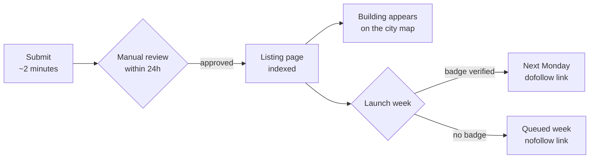

<div align="center">


# SaaSCity Launch Kit

**A launch directory that looks like a city.** Every approved listing becomes a building on a live isometric map — not row 4,812 of a table nobody scrolls.

[](https://saascity.io)
[](https://saascity.io/submit)
[](https://saascity.io)
[](directories.md)
[](LICENSE)

[**The list (150 directories)**](directories.md) · [**Badges**](badge/) · [**Submission tooling**](scripts/) · [**saascity.io**](https://saascity.io)

</div>

---

## What's in here

| | |
|---|---|
| [`directories.md`](directories.md) | 150 launch platforms and SaaS directories with Ahrefs DR, link type and entry price. Free subset of the SaaSCity dataset. |
| [`data/`](data/) | The same list as JSON and CSV, for anyone who'd rather script it than read it. `CC BY 4.0`. |
| [`scripts/`](scripts/) | The tool we use to submit to GitHub-hosted lists: fork → branch → edit → PR, with a dry-run mode. `MIT`. |
| [`badge/`](badge/) | Embed snippets for products listed on SaaSCity. |

## Why a map

A directory listing is worth something when a human sees it. Most directories are a table sorted by "featured" — the reader bounces at row 20, and listing #400 has never been looked at by anyone.

SaaSCity renders every listing as a building in one continuous isometric city. Position, height and neighbours are visible at a glance, the map is explorable, and the whole thing is one page a visitor actually moves around in. Same listings, a surface people stay on.



## Getting listed

1. **[Submit](https://saascity.io/submit)** — name, URL, one-liner, category. Takes about two minutes.
2. **Review** — every submission is read by a human within 24 hours. It is a curated directory; not everything gets in.
3. **Go live** — you get an indexed product page and a building on the map.
4. **Launch week** — launches run in weekly cycles starting Monday. Put the SaaSCity badge on your site and verify it, and your launch moves to the next Monday with a dofollow link. Skip the badge and you go into the queued week with a nofollow link.

Free listings stay free. Paid tiers (faster placement, featured slots, billboards) are on the site — this repo doesn't need to sell them to you.

## The list

150 directories worth submitting to, sorted by Domain Rating, with the link type verified on a live listing rather than copied from the directory's own marketing page.

**→ [directories.md](directories.md)**

```bash
# or take the data
curl -sL https://raw.githubusercontent.com/n1-ghosty/saascity-launch-kit/main/data/directories.json | jq '.directories[] | select(.dofollow and .pricing == "free") | .name'
```

<details>
<summary><b>Top 15 by Domain Rating</b></summary>

| Directory | DR | Link | Entry price |
|---|---:|---|---|
| [Reddit](https://www.reddit.com/) | 95 | nofollow | free |
| [Forbes Cloud 100](https://www.forbes.com/cloud100) | 94 | nofollow | free |
| [Trustpilot](https://trustpilot.com) | 94 | nofollow | freemium |
| [Digg](https://digg.com) | 92 | nofollow | free |
| [Fastcompany](http://www.fastcompany.com) | 92 | nofollow | free |
| [Sourceforge](https://sourceforge.net/) | 92 | dofollow | freemium |
| [Stack Overflow](https://stackoverflow.com) | 92 | nofollow | free |
| [TechCrunch](https://techcrunch.com) | 92 | nofollow | paid |
| [The Verge](https://www.theverge.com) | 92 | nofollow | free |
| [Wired](http://www.wired.com) | 92 | nofollow | free |
| [BostInno Startups, Tech News and Events](https://bizjournals.com) | 91 | nofollow | free |
| [Capterra](https://www.capterra.com/) | 91 | dofollow | freemium |
| [Clutch](https://clutch.co) | 91 | nofollow | free |
| [CNET](https://www.cnet.com/news) | 91 | nofollow | free |
| [Crunchbase](https://crunchbase.com) | 91 | nofollow | freemium |

[Full list →](directories.md)

</details>

The full 2,404-directory dataset — submission URLs, review turnaround, dead-link sweeps, badge-exchange requirements — is a paid product on [saascity.io](https://saascity.io). This subset is free forever and takes PRs.

## Submission tooling

Submitting to a GitHub-hosted awesome-list is the same eight steps every time: fork, sync, branch, fetch the file, insert your row in the right section with the right column count, commit, PR, repeat. [`scripts/submit_to_lists.py`](scripts/submit_to_lists.py) does it from a config file, with `--dry` so you can see every diff before anything is pushed.

```bash
python3 scripts/submit_to_lists.py --dry     # print the diffs, touch nothing
python3 scripts/submit_to_lists.py           # fork, commit, open the PRs
```

It matches an anchor line in the target file and inserts relative to it, so your row lands inside the correct section and alphabetical position instead of being appended to whatever table happened to be last. Requires the [`gh` CLI](https://cli.github.com), authenticated.

**Submit to lists you belong on.** A directory list is a curated thing and maintainers can tell — a row jammed into an unrelated section gets closed, and it should.

## Badges

Listed on SaaSCity? [Grab a badge](badge/). Verifying it on your site is what moves your launch to the next Monday with a dofollow link.

<div align="center">

&nbsp;&nbsp;

</div>

## Contributing

Dead link, moved DR, a directory that should be here and isn't — [CONTRIBUTING.md](CONTRIBUTING.md). Data corrections are the most useful PRs; the list decays without them.

## License

Code (`scripts/`) is [MIT](LICENSE). The directory data in `data/` and `directories.md` is [CC BY 4.0](data/LICENSE) — use it, ship it, sell around it, just keep the attribution line.

<div align="center">
<br>
<a href="https://saascity.io"><b>saascity.io</b></a> · built by <a href="https://github.com/n1-ghosty">@n1-ghosty</a>
</div>
