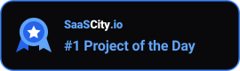

# Badges

For products listed on [SaaSCity](https://saascity.io). Verifying a badge on your own site is what moves your launch to the next Monday and turns your listing link dofollow.

| | Badge | File |
|---|---|---|
| Dark background |  | `sc-day-dark.svg` |
| Light background |  | `sc-day-light.svg` |
| Featured, dark |  | `featured-dark.svg` |
| Featured, light |  | `featured-light.svg` |

## Embed

Serve the badge from SaaSCity so it stays current, and point the link at **your listing page**, not the homepage.

```html
<a href="https://saascity.io/live/your-product" target="_blank" rel="noopener">
  
</a>
```

Markdown, for a README:

```markdown
[](https://saascity.io/live/your-product)
```

Swap `sc-day-dark` for `sc-day-light` on light backgrounds, or `featured-*` once your listing is featured.

## Rules

- Put it somewhere a person can reach — footer, about page, changelog. Not `display:none`, not behind a login.
- Keep the link crawlable. `rel="nofollow"` on your side defeats the point of the exchange.
- Don't use the featured badge unless the listing is actually featured.
